# Monitor

<div align="center">

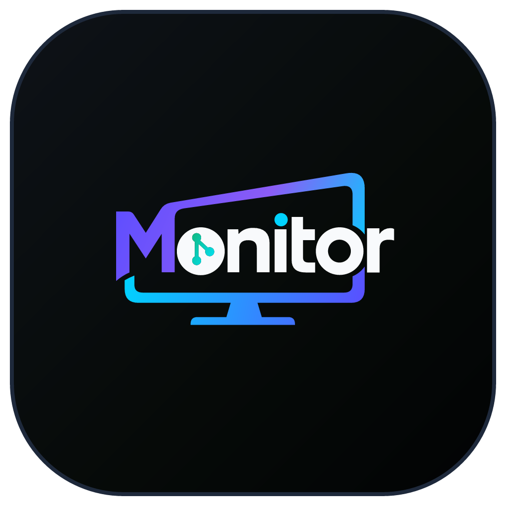

### Your workstation. In your pocket.

**A Windows host and Android companion for developers.** Check live system health, follow Git and AI agent activity, and control the tasks you explicitly allow—without streaming your desktop.

<p>
  <a href="https://github.com/morningstarweb/Monitor/releases/download/v1.0.0/Monitor_Setup.exe"></a>
  &nbsp;&nbsp;
  <a href="https://github.com/morningstarweb/Monitor/releases/download/v1.0.0/Monitor.apk"></a>
</p>

**v1.0.0** · [Latest release](https://github.com/morningstarweb/Monitor/releases/latest) · [Installation guide](docs/INSTALLATION.md) · [Source-available license](LICENSE)

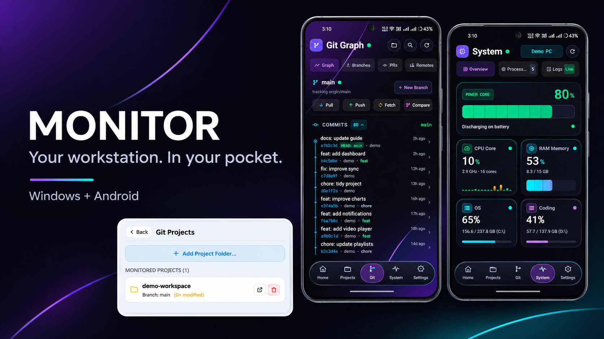

</div>

> **Preview note:** The product images below are privacy-safe recreations based on the actual v1.0 interface. Device names, accounts, paths, commit history, and measurements shown in them are demo data.

**Jump to:** [Product tour](#product-tour) · [Features](#what-monitor-does) · [Download](#download) · [Get started](#get-started) · [Security](#security-and-privacy) · [Build](#build-from-source)

## Why Monitor

When a build or coding agent is running on your Windows PC, a phone-sized remote desktop is often more screen than you need. Monitor sends structured system, Git, agent, and terminal information to an Android app designed for those tasks. Use a direct local connection when your devices share a network; optional relay paths help when they do not.

## Product tour

### Android companion

The five tabs keep the most useful information one tap away: the live host and agent overview, workspaces, Git, system health, and connection settings.

<table>
<tr>
<td align="center" width="33%">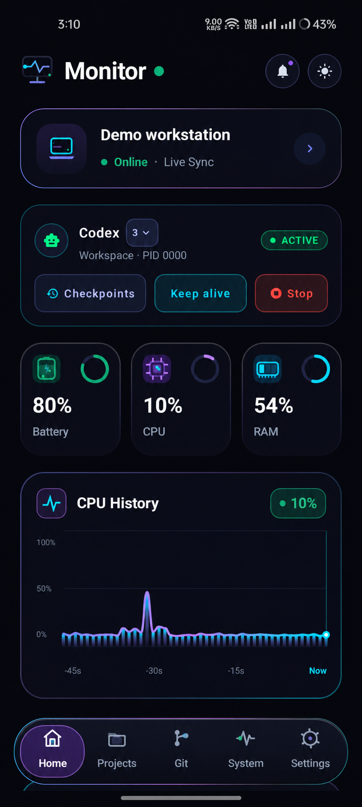<br /><sub><strong>Home</strong> · host, agent, and live metrics</sub></td>
<td align="center" width="33%">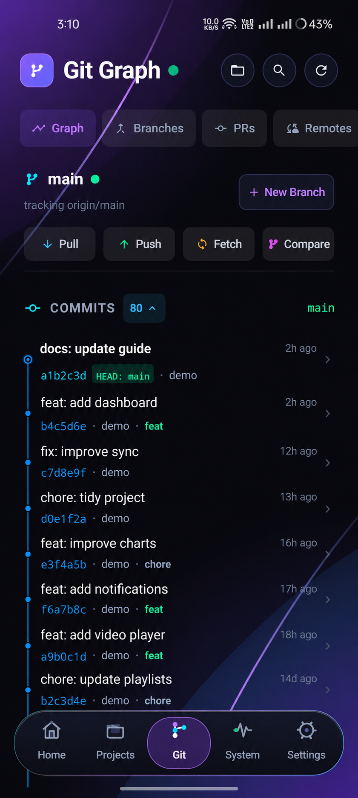<br /><sub><strong>Git</strong> · branches and commit history</sub></td>
<td align="center" width="33%">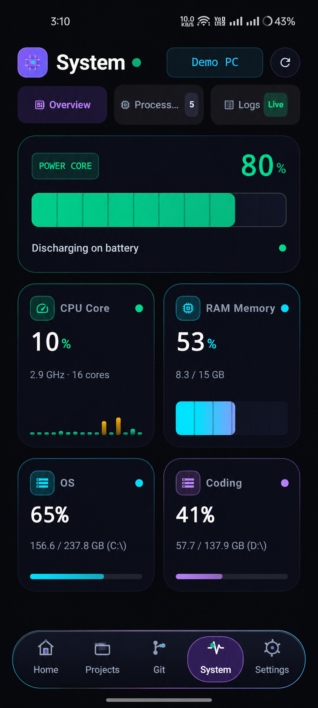<br /><sub><strong>System</strong> · battery, CPU, RAM, and disks</sub></td>
</tr>
<tr>
<td align="center">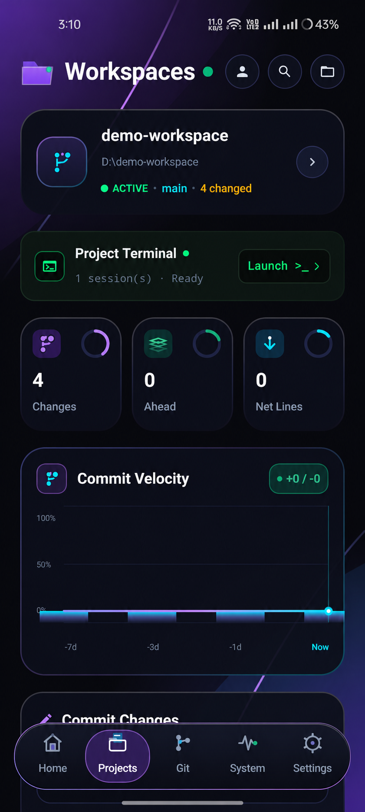<br /><sub><strong>Workspaces</strong> · project and terminal status</sub></td>
<td align="center">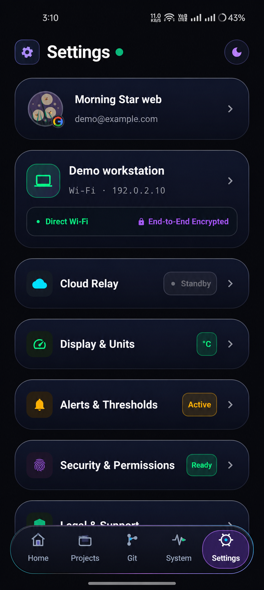<br /><sub><strong>Settings</strong> · connection and permissions</sub></td>
<td></td>
</tr>
</table>

### Windows desktop

The lightweight tray app keeps pairing, projects, cloud sync, system health, and permissions on the host PC. These desktop panels have been framed to show only the Monitor interface.

<table>
<tr>
<td align="center" width="50%">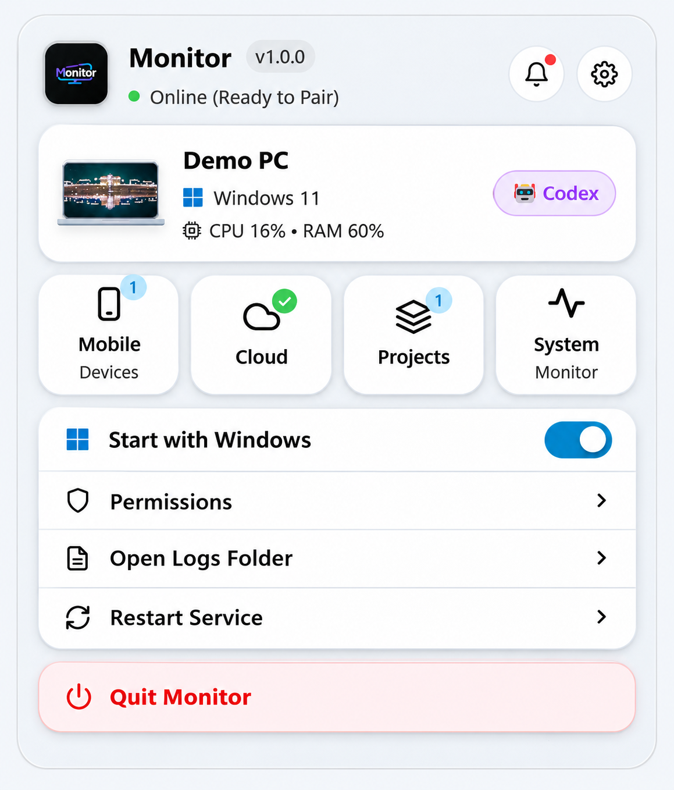<br /><sub><strong>Tray</strong> · the host control center</sub></td>
<td align="center" width="50%">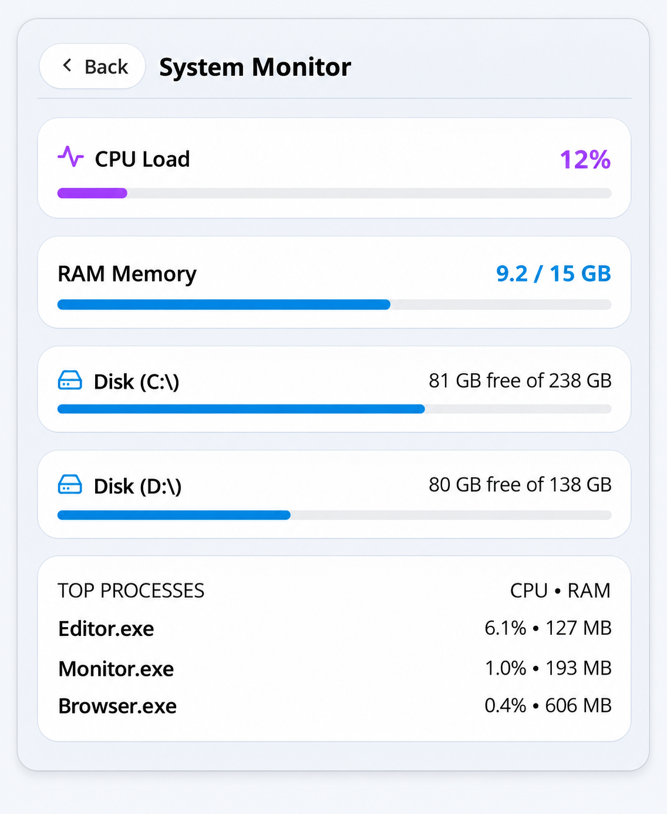<br /><sub><strong>System Monitor</strong> · local resource view</sub></td>
</tr>
</table>

<details>
<summary><strong>See the rest of the Windows panels</strong></summary>

<br />

<table>
<tr>
<td align="center" width="50%">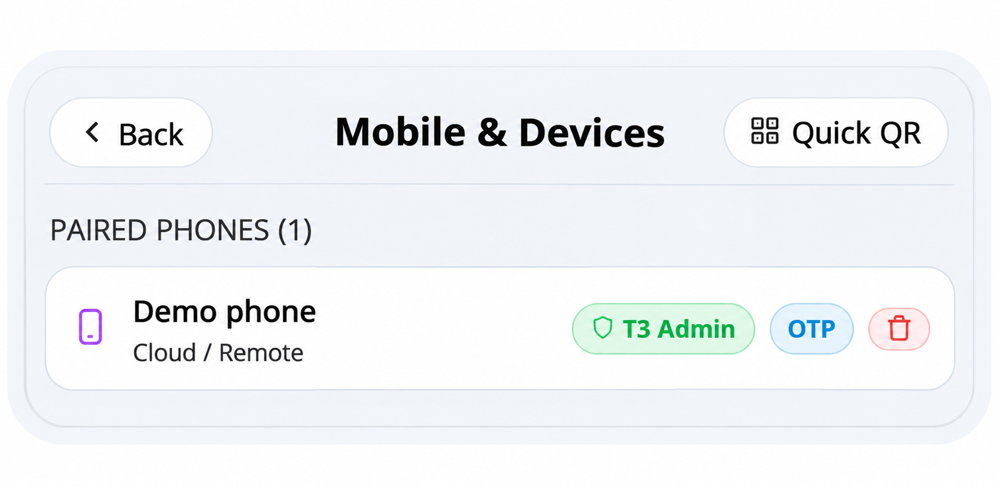<br /><sub>Mobile &amp; Devices</sub></td>
<td align="center" width="50%">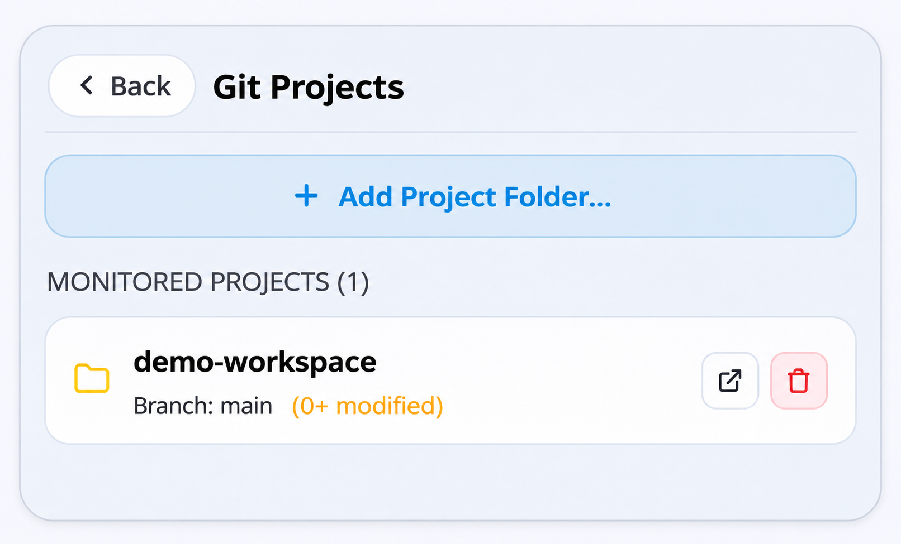<br /><sub>Git Projects</sub></td>
</tr>
<tr>
<td align="center">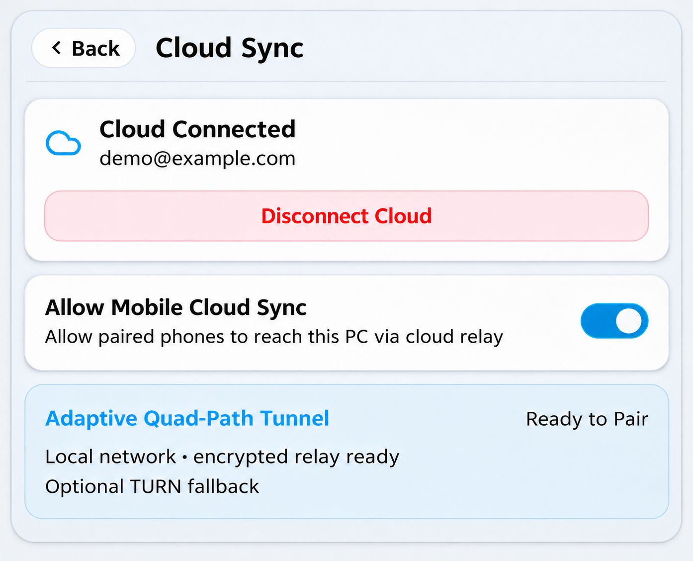<br /><sub>Cloud Sync</sub></td>
<td align="center">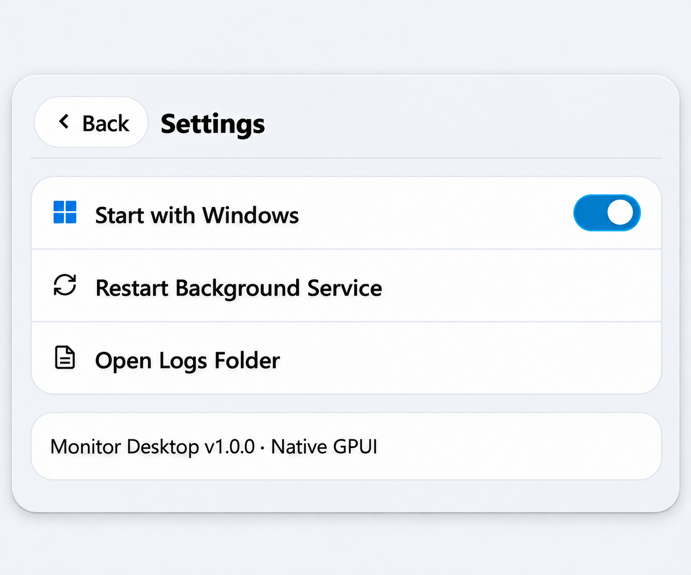<br /><sub>Settings</sub></td>
</tr>
</table>

</details>

<details>
<summary><strong>Installer and onboarding previews</strong></summary>

<br />

<table>
<tr>
<td align="center" width="38%"><br /><sub>Windows installer · GPUI Native Glass</sub></td>
<td align="center" width="38%"><br /><sub>Compatibility installer · Win32 GDI</sub></td>
<td align="center" width="24%">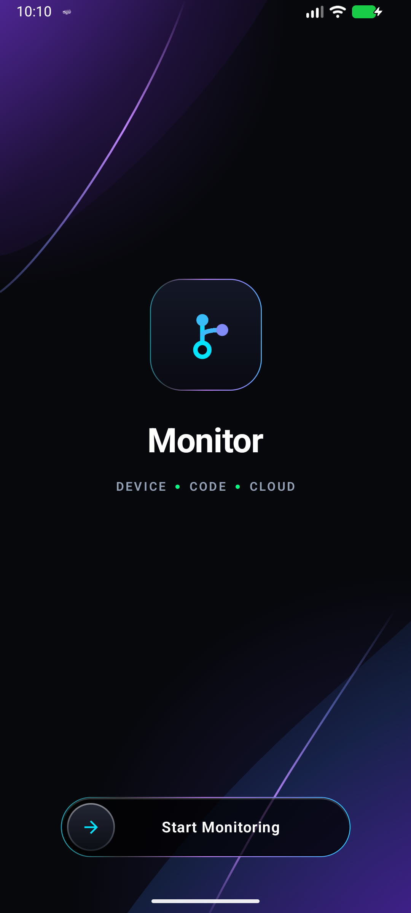<br /><sub>Android onboarding</sub></td>
</tr>
</table>

</details>

## What Monitor does

| Area | On your phone |
| --- | --- |
| **System health** | See CPU, memory, disk, process, and battery information from the Windows host, including recent history. |
| **Git workspaces** | Browse branches, commits, and diffs; review changes and use supported sync and pull request actions. |
| **AI agent activity** | Follow supported coding runtimes, see active sessions, and use shadow checkpoints for monitored worktrees. |
| **Terminal and controls** | View command output and run host-approved commands when remote execution is enabled. |
| **Connection paths** | Pair over local Wi-Fi or Tailscale, with optional peer or cloud relay paths when configured. |

Monitor does not transmit a video of your desktop. Host permissions and device trust determine which control actions are available.

## Download

**Use the release packages for installation.** GitHub's **Code → Download ZIP** contains source files, not the Windows installer or Android APK.

| Platform | Release package | What it includes |
| --- | --- | --- |
| Windows 10/11 (x64) | [Monitor_Setup.exe](https://github.com/morningstarweb/Monitor/releases/download/v1.0.0/Monitor_Setup.exe) · 62.5 MiB | Tray host, background service, uninstaller, and bundled MinGit. |
| Android 11+ | [Monitor.apk](https://github.com/morningstarweb/Monitor/releases/download/v1.0.0/Monitor.apk) · 46.2 MiB | Official signed Android companion. |
| Integrity | [CHECKSUMS.sha256](https://github.com/morningstarweb/Monitor/releases/download/v1.0.0/CHECKSUMS.sha256) | SHA-256 digests for both packages. |

Current **v1.0.0** SHA-256 values:

```text
Monitor_Setup.exe  9bc892f6700fa6eb35587e64fbce1f2676824ff593fe889fbd029ef2ae6d2155
Monitor.apk        179bdf42c3860d77955d0423b282b772c5705cb72618dba10deeb8cabbf97e01
```

On Windows, verify the installer with `Get-FileHash .\Monitor_Setup.exe -Algorithm SHA256`. The v1.0.0 Windows installer is unsigned and may trigger SmartScreen; check the release hash before deciding whether to run it.

## Get started

1. **Install the Windows host** from the release package, then open **Monitor** from the Start menu or tray. Standard installation does not require administrator privileges.
2. **Install the Android APK** from the same release and open the companion app.
3. **Pair the devices.** Sign in with the same Google account on both devices, or choose local Wi-Fi/Tailscale/manual QR pairing. Use **Mobile & Devices** on Windows for the QR or verification code and complete the device trust step.
4. **Choose host permissions.** Remote terminal, Git rollback, and process termination are off by default. Enable only the actions you intend to use from the Windows tray.

For firewall setup, silent installation, or sign-in help, see the [Installation guide](docs/INSTALLATION.md) and [Troubleshooting guide](docs/TROUBLESHOOTING.md).

## Requirements

| Component | Minimum |
| --- | --- |
| Windows host | Windows 10 version 1903+ or Windows 11, x64; about 150 MB free in `%LOCALAPPDATA%\Programs\Monitor`. |
| Android companion | Android 11+ (API 30); supported ABIs: `arm64-v8a`, `armeabi-v7a`, `x86`, `x86_64`. |
| Network | Local Wi-Fi/Ethernet on TCP 9480, Tailscale, or optional outbound HTTPS/WSS on 443. |

## Security and privacy

- **Encrypted device links:** Application messages use `Noise_IK_25519_ChaChaPoly_SHA256` across supported direct and relay paths. The relay carries encrypted envelopes.
- **Stored credentials:** Windows protects the host's static Noise key with DPAPI; Android uses `AndroidKeyStore` AES-256-GCM for its local secure store. Hardware backing depends on the device.
- **Guarded control:** Trusted devices and host switches gate sensitive actions. Remote commands use a Windows Job Object with `KILL_ON_JOB_CLOSE` to bound process lifetime; this is not a general-purpose sandbox.
- **Minimal collection:** Monitor has no third-party analytics or crash-tracking SDK and does not capture desktop video. Read the [privacy policy](PRIVACY.md) and [security policy](SECURITY.md).

The connection order is direct LAN/Tailscale, WebRTC peer-to-peer where available, optional TURN, then an optional Cloudflare WSS relay. TURN is disabled in the default `strict_free` configuration. See [Networking & Transport](docs/networking.md) and [Self-Hosting](SELF_HOSTING.md) for details.

## Documentation

| Using Monitor | Building Monitor |
| --- | --- |
| [Installation](docs/INSTALLATION.md) · [FAQ](docs/FAQ.md) | [Engineering index](docs/README.md) · [Build guide](docs/BUILD.md) |
| [Troubleshooting](docs/TROUBLESHOOTING.md) · [Support](SUPPORT.md) | [Architecture](docs/architecture.md) · [Networking](docs/networking.md) |
| [Changelog](CHANGELOG.md) · [Roadmap](docs/ROADMAP.md) | [Security architecture](docs/security.md) · [Development workflow](docs/development.md) |
| [Privacy](PRIVACY.md) · [Security](SECURITY.md) | [Release process](docs/release.md) · [Protocol schema](docs/protocol-v2.schema.json) |

## Build from source

The public client is an eight-crate Rust 2024 workspace in `desktop/` and an eight-module Kotlin 2.1 / Jetpack Compose app in `android/`. The hosted Cloudflare service implementation is private; client code and the [self-hosting guide](SELF_HOSTING.md) are available here.

<details>
<summary><strong>Architecture, workspace layout, and verification commands</strong></summary>

<br />

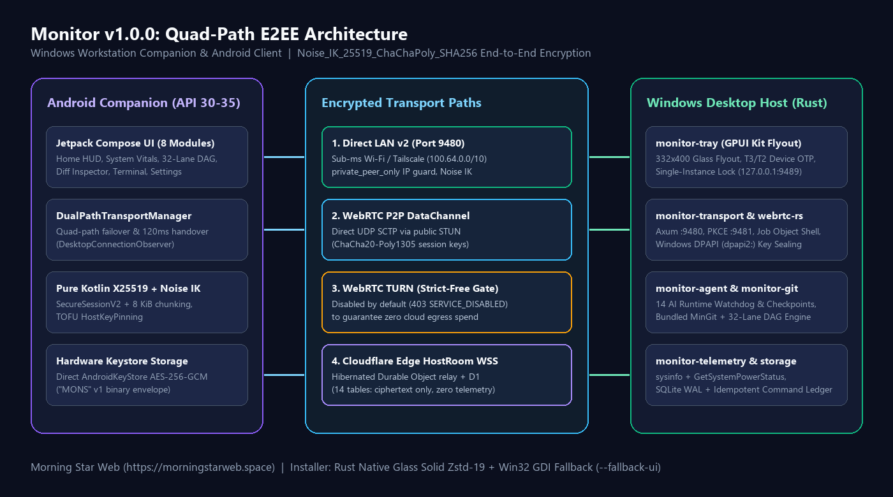

**Workspace layout**

- `desktop/`: `monitor-core`, `monitor-storage`, `monitor-telemetry`, `monitor-git`, `monitor-transport`, `monitor-agent`, `monitor-tray`, and `monitor-installer`.
- `android/`: `:app`, `:core:model`, `:core:network`, `:core:common`, `:core:designsystem`, `:feature:dashboard`, `:feature:gitworkspace`, and `:feature:onboarding`.
- `installer/` and `scripts/`: packaging, branding, release, and verification tools.

```powershell
# Rust host (stable x86_64-pc-windows-msvc with Visual Studio C++ Build Tools)
Push-Location desktop
cargo fmt --all -- --check
cargo check --workspace --all-targets
cargo clippy --workspace --all-targets -- -D warnings
cargo test --workspace --exclude monitor-tray --offline
cargo test -p monitor-tray --offline
Pop-Location

# Android companion (JDK 21 and Android SDK Platform 35)
Push-Location android
.\gradlew.bat testDebugUnitTest testReleaseUnitTest lintDebug lintRelease assembleDebug
Pop-Location

# Brand and contract checks (Python 3.11+)
python scripts/sync_brand.py --check
python tests/test_empirical_m3_adversarial.py
python tests/e2e/runner.py
```

</details>

## Contributing and license

Bug reports, documentation improvements, and client pull requests are welcome. Start with [CONTRIBUTING.md](CONTRIBUTING.md) and [CODE_OF_CONDUCT.md](CODE_OF_CONDUCT.md).

Monitor's first-party public source is **source-available under the [PolyForm Noncommercial License 1.0.0](LICENSE)**. Noncommercial inspection, modification, building, and redistribution are permitted under its terms; commercial use requires a separate license from Morning Star Web. See [third-party notices](THIRD_PARTY_NOTICES.txt) and the [trademark policy](TRADEMARK.md).

---

<div align="center">

**Morning Star Web** · [morningstarweb.space](https://morningstarweb.space/) · [contact@morningstarweb.space](mailto:contact@morningstarweb.space)

</div>
