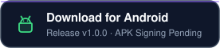

<div align="center">


<h1>Monitor</h1>

<p><strong>Keep watch on your Windows workstation from anywhere.</strong></p>

<p>
Monitor is a native Windows host service paired with an Android companion app for developers. Track hardware load, follow AI coding agents, browse Git branch graphs, and run bounded terminal commands over Noise-encrypted peer links without streaming remote desktop video.
</p>

<p>
  <a href="https://github.com/morningstarweb/Monitor/releases/download/v1.0.0/Monitor_Setup.exe">
    
  </a>
  &nbsp;&nbsp;
  <a href="https://github.com/morningstarweb/Monitor/releases/download/v1.0.0/Monitor.apk">
    
  </a>
</p>

<p>
  <strong>v1.0.0</strong> &middot;
  <a href="https://github.com/morningstarweb/Monitor/releases/latest">Latest release</a> &middot;
  <a href="https://github.com/morningstarweb/Monitor/releases">All releases</a> &middot;
  <a href="https://github.com/morningstarweb/Monitor/releases/download/v1.0.0/CHECKSUMS.sha256">SHA-256 checksums</a> &middot;
  <a href="LICENSE">PolyForm Noncommercial 1.0.0</a>
</p>

<p>
  <a href="#why-monitor">Overview</a> &middot;
  <a href="#download">Download</a> &middot;
  <a href="#what-you-can-do">Features</a> &middot;
  <a href="#getting-started">Getting Started</a> &middot;
  <a href="#security-and-privacy">Security</a> &middot;
  <a href="#documentation">Documentation</a>
</p>

</div>

---

## Why Monitor

Stepping away from your desk mid-build or mid-agent run usually leaves you guessing or wrestling with a sluggish screen-sharing client on a small phone display. Monitor takes a different approach: instead of pushing pixels, the Windows host sends structured telemetry, Git repository state, watchdog snapshots, and shell output directly to your Android device.

Every connection runs end-to-end encrypted between your own devices, works offline over local Wi-Fi or Tailscale, and keeps destructive actions off by default until you approve them from your desktop tray.

---

## Download

**For regular users:** download the installer for your platform below instead of cloning or downloading source archives from GitHub's Code menu.

| Platform | Package | Link | Notes |
| --- | --- | --- | --- |
| Windows 10 / 11 (x64) | Installer EXE (`62.5 MiB`) | [Download `Monitor_Setup.exe`](https://github.com/morningstarweb/Monitor/releases/download/v1.0.0/Monitor_Setup.exe) | Single full installer. Includes desktop tray host, background service, uninstaller, and portable MinGit. |
| Android 11+ (API 30-35) | Companion APK (`46.2 MiB`) | [Download `Monitor.apk`](https://github.com/morningstarweb/Monitor/releases/download/v1.0.0/Monitor.apk) | Official release build signed with Morning Star Web key. Install directly on Android phone. |
| Release Verification | Checksums | [`CHECKSUMS.sha256`](https://github.com/morningstarweb/Monitor/releases/download/v1.0.0/CHECKSUMS.sha256) | Verify file integrity locally before running downloaded packages. |

> **Windows SmartScreen notice:** `v1.0.0` Windows binaries are unsigned under a zero-budget distribution model. Verify the SHA-256 digest against [`CHECKSUMS.sha256`](https://github.com/morningstarweb/Monitor/releases/download/v1.0.0/CHECKSUMS.sha256) first; if SmartScreen prompts, review the verified hash before choosing **More info** and **Run anyway**.

---

## What You Can Do

### See what your machine is actually spending resources on
The Windows host samples CPU usage per core, 60-minute CPU and memory history, swap allocation, disk free space, running processes, and Windows AC/battery state directly from `sysinfo` and Win32 power APIs. When an idle script spins out of control, you can spot it immediately and terminate the process from your phone if host permissions allow it.

### Review branches, commits, and diffs on mobile
Monitor renders repository DAG graphs across up to 32 branch lanes, lets you inspect per-commit diffs line by line, stage or unstage changes, switch branches (`main` and `master` stay protected), sync remotes, and review or merge GitHub pull requests through its sandboxed MinGit runtime.

### Keep a safety net under AI coding agents
Monitor detects 14 AI coding runtimes (including Antigravity, Claude, Codex, Cursor, Windsurf, Gemini, Copilot, Aider, Cline/Roo, Continue, Goose, and OpenCode) with `.git/index` activity fallback. Whenever monitored worktrees change on disk, Monitor captures non-destructive shadow checkpoints under `refs/monitor/checkpoints/...` so you can roll back unwanted edits cleanly with an automatic pre-rollback snapshot.

### Run bounded shell commands without exposing an open remote desktop
Authorized phones can run commands and inspect output inside isolated Win32 Job Objects (`KILL_ON_JOB_CLOSE`). Remote execution, Git rollbacks, and delete operations stay disabled by default and require both device verification (`T3 Admin`) and explicit host tray switches.

---

## Product Showcase

Monitor ships with a hardware-accelerated **GPUI Native Glass** Windows installer that falls back cleanly to a pure **Win32 GDI** wizard on virtual machines or RDP sessions (`--fallback-ui`), paired with an **Android Jetpack Compose** companion built around quick QR/OTP onboarding.

<table>
<tr>
<td align="center" width="38%">
  
  <br /><sub><strong>Windows Installer</strong>: GPUI Native Glass setup</sub>
</td>
<td align="center" width="38%">
  
  <br /><sub><strong>Compatibility UI</strong>: Win32 GDI fallback (<code>--fallback-ui</code>)</sub>
</td>
<td align="center" width="24%">
  
  <br /><sub><strong>Android Client</strong>: Onboarding and device pairing</sub>
</td>
</tr>
</table>

---

## Getting Started

**User journey:** Download -> Install -> Connect -> Use

1. **Install on Windows:** Download `Monitor_Setup.exe`, check its SHA-256 digest (`0f0b158458d810fe5058e1cc3840f3312eb078279f6ebfa2d39fe993650863a2`), and run the installer. No administrator privileges are required.
   ```powershell
   Get-FileHash .\Monitor_Setup.exe -Algorithm SHA256
   ```
2. **Launch the tray companion:** Start **Monitor** from the Start Menu or Desktop shortcut. Clicking the tray icon opens the desktop control flyout (`Projects`, `Mobile & Devices`, `Permissions`, `System Monitor`, `Cloud`, and `Settings`).
3. **Pair your phone (`T3 Admin`):** Sign in with the same Google account on Windows and Android, or tap **Use Local Wi-Fi / Tailscale / Manual QR** on Android to stay offline. Scan the desktop QR code or enter the 6-digit verification code from **Mobile & Devices** to unlock control actions.
4. **Set your boundaries:** Keep remote terminal, Git rollback, and process kill switches toggled off until you actually want them.

For firewall rules, headless `--silent` installs, and Google Sign-In notes, see the [**Installation Guide**](docs/INSTALLATION.md) and [**Troubleshooting Guide**](docs/TROUBLESHOOTING.md).

---

## System Requirements

| Platform | Minimum Requirement |
| --- | --- |
| **Windows Host** | Windows 10 (1903+) or Windows 11 (`x86_64`), ~150 MB free disk space in `%LOCALAPPDATA%\Programs\Monitor` |
| **Android Client** | Android 11+ (`minSdk = 30`, `targetSdk = 35`), 16 KB page-size compatible (`arm64-v8a`, `armeabi-v7a`, `x86`, `x86_64`) |
| **Network** | Local Wi-Fi or Ethernet (`TCP 9480`), Tailscale (`100.64.0.0/10`), or outbound HTTPS/WSS (`443`) |

---

## Security and Privacy

- **End-to-End Encryption:** Application payloads across local LAN v2, WebRTC P2P DataChannels, and the Cloudflare Edge WSS relay use `Noise_IK_25519_ChaChaPoly_SHA256`. Relays forward opaque ciphertext envelopes only.
- **Native Credential Storage:** Windows seals the host static Noise key using Win32 DPAPI (`dpapi2:`); Android seals tokens and identity material in hardware-backed `AndroidKeyStore` AES-256-GCM (`SecureStorage`).
- **Fail-Closed Execution & Revocation:** MinGit disables external protocol helpers (`protocol.ext.allow=never`) and validates repository paths; commands execute inside Win32 Job Objects; revoked devices are permanently blocked via SQLite `viewer_trust` tombstones.
- **No Telemetry Harvesting:** Monitor collects zero third-party analytics or crash-tracking telemetry and never records desktop screen pixels. Review [SECURITY.md](SECURITY.md) (`contact@morningstarweb.space`) and [PRIVACY.md](PRIVACY.md).

### Adaptive Transport Paths

```text
1. Direct LAN v2 (Port 9480 over local Wi-Fi, Ethernet, or Tailscale)
        | (unavailable)
        v
2. WebRTC P2P DataChannel (STUN-negotiated encrypted SCTP channel)
        | (symmetric NAT)
        v
3. Optional TURN Relay (Off by default under strict_free: 403 SERVICE_DISABLED)
        | (fallback)
        v
4. Cloudflare Edge HostRoom WSS (Hibernated relay carrying Noise IK envelopes)
```

---

## Documentation

| For Users | For Developers |
| --- | --- |
| [Installation Guide](docs/INSTALLATION.md) | [Engineering Docs Index](docs/README.md) |
| [Troubleshooting Guide](docs/TROUBLESHOOTING.md) | [System Architecture](docs/architecture.md) |
| [Frequently Asked Questions](docs/FAQ.md) | [Networking & Transport](docs/networking.md) |
| [Changelog](CHANGELOG.md) | [Security Architecture](docs/security.md) |
| [Support](SUPPORT.md) | [Build From Source](docs/BUILD.md) |
| [Privacy Policy](PRIVACY.md) | [Self-Hosting Guide](SELF_HOSTING.md) |

---

## For Developers

**Developer journey:** Explore -> Build -> Understand -> Contribute

Monitor is split into an 8-crate **Rust 2024** workspace (`desktop/`) and an 8-module **Kotlin 2.1 / Jetpack Compose** app (`android/`). Client source code lives here publicly; reference Cloudflare Worker infrastructure (`cloud/`) stays private in `Monitor-Source-Code` and is documented for self-hosting in [SELF_HOSTING.md](SELF_HOSTING.md).

<details>
<summary><strong>Expand architecture diagram, workspace layout, and local build commands</strong></summary>

<br />


### Workspace Structure

- **`desktop/` (Rust 2024):** `monitor-core`, `monitor-storage`, `monitor-telemetry`, `monitor-git`, `monitor-transport`, `monitor-agent`, `monitor-tray`, `monitor-installer` (with standalone `monitor-uninstaller` and `pack-payload`).
- **`android/` (Kotlin 2.1, API 30-35):** `:app`, `:core:model`, `:core:network`, `:core:common`, `:core:designsystem`, `:feature:dashboard`, `:feature:gitworkspace`, `:feature:onboarding`.
- **`installer/` & `scripts/`:** Win32 installer manifests, runtime packaging helpers, CycloneDX SBOM generator, and contract test runners.

### Local Build & Verification

```powershell
# Desktop Host (Rust stable x86_64-pc-windows-msvc + VS C++ Build Tools)
Push-Location desktop
cargo fmt --all -- --check
cargo check --workspace --all-targets
cargo clippy --workspace --all-targets -- -D warnings
cargo test --workspace --exclude monitor-tray --offline
cargo test -p monitor-tray --offline
Pop-Location

# Android Companion (JDK 21 + Android SDK Platform 35)
Push-Location android
.\gradlew.bat testDebugUnitTest testReleaseUnitTest lintDebug lintRelease assembleDebug
Pop-Location

# Brand sync and contract tests (Python 3.11+)
python scripts/sync_brand.py --check
python tests/test_empirical_m3_adversarial.py
python tests/e2e/runner.py
```

Additional references: [Development Workflow](docs/development.md) &middot; [Release & Packaging](docs/release.md) &middot; [Protocol v2 JSON Schema](docs/protocol-v2.schema.json) &middot; [Roadmap](docs/ROADMAP.md)

</details>

---

## Contributing and License

- **Contributing:** Bug reports, documentation fixes, and client pull requests are welcome. Read [CONTRIBUTING.md](CONTRIBUTING.md) and [CODE_OF_CONDUCT.md](CODE_OF_CONDUCT.md) before opening a pull request.
- **License (Source-Available):** First-party source code is licensed under the **PolyForm Noncommercial License 1.0.0** ([LICENSE](LICENSE)). You may inspect, build, modify, and redistribute the software for noncommercial purposes; commercial usage or resale requires written licensing from Morning Star Web. See [THIRD_PARTY_NOTICES.txt](THIRD_PARTY_NOTICES.txt) for dependency notices and [TRADEMARK.md](TRADEMARK.md) for brand usage rules.

---

<div align="center">

**Morning Star Web**  
[morningstarweb.space](https://morningstarweb.space/) &middot; [contact@morningstarweb.space](mailto:contact@morningstarweb.space)

</div>
