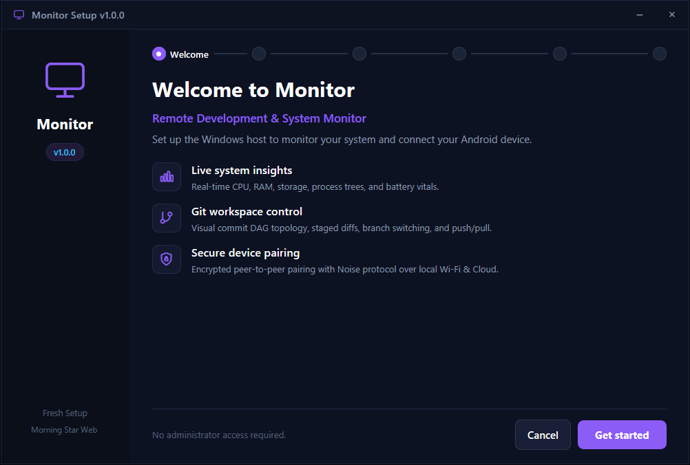
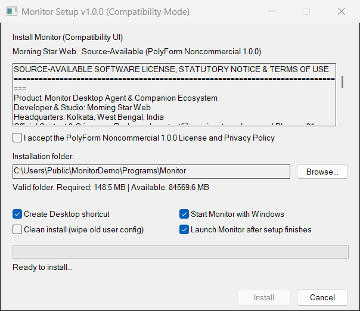
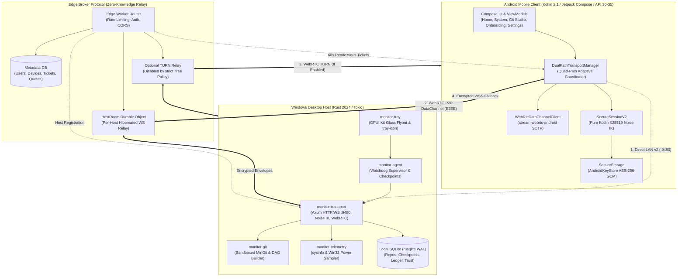

# Monitor — Remote Development & Workstation Sentinel

[](config/brand.toml)
[-blue.svg)](LICENSE)
[](docs/INSTALLATION.md)
[](desktop/)
[](android/)
[](https://github.com/morningstarweb/Monitor-Releases/releases/latest)

**Free for Noncommercial Use • Zero Cloud Plaintext Telemetry • Noise IK E2EE • Local-First**

> [!NOTE]
> Looking for ready-to-install Windows Setup (`.exe`) or Android Companion (`.apk`) downloads? Visit **[morningstarweb/Monitor-Releases](https://github.com/morningstarweb/Monitor-Releases/releases/latest)** and read the **[Installation Guide](docs/INSTALLATION.md)**.

**Monitor (v1.0.0)** is a **Remote Development & Workstation Sentinel** (not an RDP/VNC screen-capture streamer). It pairs a native Windows desktop host daemon and **GPUI Kit** system tray flyout with a **Jetpack Compose** Android companion application to deliver real-time hardware telemetry, a visual 32-lane Git DAG studio, bounded remote command terminals, and universal watchdog checkpoints with zero cloud plaintext exposure.


### Visual Preview

| Windows GPUI Glass Installer | Win32 Compatibility Installer (`--fallback-ui`) | Android Onboarding (`Compose`) |
| :---: | :---: | :---: |
|  |  |  |

---

## Key Features

- **Live System Telemetry:** Real-time per-core CPU utilization, 60-minute CPU/RAM history, memory & swap allocation, disk capacity (`sysinfo`), Windows battery status (`GetSystemPowerStatus`), and top process monitoring + termination.
- **Git Graph Studio & Workspace Management:**
  - Visual DAG graph layout with topological sorting and smooth cubic Bézier / chamfer connectors across up to 32 active branch lanes.
  - Commit file history inspection (`git show -m --first-parent --name-status` / `--numstat`) and syntax-highlighted line-by-line Diff Inspector.
  - Full remote Git operations via bundled portable MinGit: branch create/switch/delete (`main`/`master` protected)/merge/smart merge-all, stage/unstage, explicit token-confirmed file discard, commit, fetch, pull, push, and GitHub PR list/merge.
- **Bounded Remote Terminal:** Remote command execution over HTTP (`POST /terminal/run`, `POST /terminal/stop` and Protocol v2 `terminal.start`/`terminal.stop`) with live output streaming (`ServerEvent::TerminalOutput`) confined inside a Win32 Job Object (`KILL_ON_JOB_CLOSE`).
- **Universal Watchdog & Shadow Checkpoints:** Automated detection of **14 AI/IDE agent runtimes** (`Antigravity`, `Claude`, `Codex`, `Cursor`, `Windsurf`, `Gemini`, `Copilot`, `Aider`, `Cline / Roo`, `Continue`, `Goose`, `OpenCode`, etc.) plus workspace `.git/index` activity fallback, automatic dirty-tree shadow Git checkpoints (`refs/monitor/checkpoints/...`), manual phone snapshots (`+ Save`), snooze/ack alerts, mass-change detection, keep-awake management, and pre-rollback safety snapshots.
- **Quad-Path Adaptive Transport Architecture:**
  1. **Direct LAN Stream v2:** Sub-millisecond local transport over Wi-Fi / Ethernet / Tailscale (`100.64.0.0/10`) on port `9480` (`Noise_IK_25519_ChaChaPoly_SHA256`, `private_peer_only` IP guard + `LanEndpointPolicy`). Discovery uses local IP / Tailscale probing, HostRoom `host_metadata`, and Tray QR codes.
  2. **WebRTC P2P DataChannel:** Direct encrypted SCTP DataChannel (`monitor-telemetry`) using STUN (`stun.cloudflare.com:3478`, `stun.l.google.com:19302`) and ChaCha20-Poly1305 session keys.
  3. **WebRTC TURN Relay (Off by Default under `strict_free`):** Managed Cloudflare TURN returns `403 SERVICE_DISABLED` by default to guarantee zero mandatory cloud spend; optional self-hosted TURN or budget-guarded owner quota is supported (`SELF_HOSTING.md`).
  4. **Cloudflare Edge Relay (WSS):** Always-on encrypted WebSocket relay mediated by per-host `HostRoom` Durable Objects with WebSocket Hibernation.
  - **Instant Network Handover:** Android `ConnectivityManager` (`DesktopConnectionObserver`) detects validated Wi-Fi <-> 5G switches (`120ms` debounce), triggers OkHttp pool eviction, WebRTC teardown, `promoteFallbackPath()`, and sub-second recovery.
- **Same-Gmail + Per-Device OTP/QR Verification (`T3 Admin`):** Signing into Google keeps unverified phones locked at the **"Verify This Device"** gate until verified via 6-digit OTP or QR code (over LAN or remote Protocol v2 E2EE `auth.verify_otp`), promoting verified devices to `T3 Admin` while desktop tray toggles enforce fail-closed controls over remote terminal, rollback, and delete operations.
- **End-to-End Encryption (E2EE):** `Noise_IK_25519_ChaChaPoly_SHA256` secures telemetry, Git data, checkpoints, and control commands across LAN v2, WebRTC, and Cloud WSS. Windows desktop seals Noise private keys with Win32 DPAPI (`dpapi2:`); Android stores credentials in direct `AndroidKeyStore` AES-256-GCM (`SecureStorage`).

---

## Architecture Overview



---

## Subsystem Code Map

### 1. Windows Desktop Host (`desktop/`)
Built with Rust 2024 edition across eight workspace crates:
- **`monitor-core`:** Protocol v2 wire models (`EnvelopeV2`, 28 `MessageType` variants), operation tiers (`T0`–`T3`), canonical SHA-256 command digesting, and auto-generated `BrandConfig`.
- **`monitor-storage`:** Dual-handle SQLite WAL persistence (`conn` + read-only `read_conn`), repository/checkpoint registry, fail-closed permission defaults, permanent viewer revocation tombstones (`viewer_trust`), and crash-recoverable idempotent `command_ledger`.
- **`monitor-telemetry`:** Windows hardware sensor sampling (per-core CPU, 60m CPU/RAM histories, memory/swap, disks, processes) via `sysinfo 0.33.1` + Win32 `GetSystemPowerStatus`.
- **`monitor-git`:** Hardened portable MinGit runner (`MONITOR_GIT_PATH` + exe-relative discovery, strict `path_guard`, `protocol.ext.allow=never`), topological DAG layout (32 lanes), unified diffs, GitHub PR queries/merges, and shadow `CheckpointEngine`.
- **`monitor-transport`:** Axum server (`:9480` with `private_peer_only` + `native_client_only`), OAuth PKCE loopback (`127.0.0.1:9481`), Noise IK (`snow`), WebRTC host peer (`webrtc 0.21.1`), Win32 Job Object command runner, DPAPI `key_storage/`, and `HostRoom` outbound client.
- **`monitor-agent`:** Multi-thread Tokio runtime, 14-agent process classifier (`UNIVERSAL_AGENT_CATALOG`), `.git/index` mtime fallback, dirty-tree auto-checkpoint scanner, alert evaluator, and `SetThreadExecutionState` keep-awake.
- **`monitor-tray`:** Native `tray-icon` + `gpui-kit 0.10.0` borderless flyout UI (`Projects`, `Mobile & Devices` OTP/QR + `T2`/`T3` switcher, `Permissions`, `Cloud`, `System Monitor`, `Notifications`, `Settings`) with `:9489` TCP single-instance lock.
- **`monitor-installer`:** GPUI Kit **Native Glass Windows Installer** (`monitor-installer`), Solid Zstd level-19 `MONPAK01` payload packer (`pack-payload`), and standalone `monitor-uninstaller`.

### 2. Android Mobile Companion (`android/`)
Clean Architecture Kotlin `2.1.0` + Jetpack Compose app (`minSdk = 30`, `targetSdk = 35`, Java 21):
- **`:app`:** Navigation tabs, `AppLockGate`, `DesktopConnectionObserver` network handover, `AlertNotificationManager` (`CHANNEL_COMPANION` + alert severity channels), and `ActiveSessionService` (`connectedDevice` FGS).
- **`:core:model`:** Kotlin serialization models matching Protocol v2 and desktop DTOs.
- **`:core:network`:** `DualPathTransportManager`, `LanTransportV2`, `WebRtcDataChannelClient`, `CloudRelayTransportV2`, `V2TransportCoordinator`, constant-shape RFC 7748 Kotlin `X25519` + `SecureSessionV2`, `V2RequestCorrelator`, `EnvelopeChunkAssembler`, `LanEndpointPolicy`, `TokenStorage`, and `SecureStorage` (`AndroidKeyStore` AES-256-GCM).
- **`:core:common`:** `BrandConfig`, `BiometricAuthManager`, `AppLockAuthPolicy`, `DestructiveActionGate`, `ReconnectPolicy`, and `AlertNotifier`.
- **`:core:designsystem`:** "Dark Obsidian Glass" and Light Aurora Compose theme, custom canvases, and charts.
- **`:feature:dashboard`:** Telemetry dashboard (`Home`, `System`, `Settings`), watchdog checkpoints (`+ Save` + rollback), and statutory dialogs.
- **`:feature:gitworkspace`:** Topological Bezier Git Graph studio, diff inspector, branch manager, PR viewer/merge, and live command terminal.
- **`:feature:onboarding`:** ML Kit QR scanner, Google OAuth sign-in, and **"Verify This Device"** (`T3 Admin` OTP/QR gate) with non-GMS fallback.

### 3. Edge Broker Protocol (`SELF_HOSTING.md`)
Serverless broker running on Cloudflare Workers, D1 (14 tables, migrations `0001`–`0006`), and 3 SQLite Durable Objects (`HostRoom`, `RateLimiterDO`, `QuotaReservationDO`). The reference Cloudflare backend (`cloud/`) resides in the private `Monitor-Source-Code` repository and is documented for independent self-hosting in [SELF_HOSTING.md](SELF_HOSTING.md).

### 4. Windows Installer (`installer/` & `desktop/crates/monitor-installer/`)
Pure-Rust Native Glass per-user installer (`monitor-installer`) bundling `Monitor.exe`, standalone `monitor-uninstaller.exe`, MinGit `2.56.1.windows.1` portable runtime, MSVC CRT DLLs (`installer/redist/`), `EULA.txt`, and `PRIVACY.txt`. Legacy Inno Setup definitions remain in `installer/monitor.iss` (`desktop/installer.iss`).

---

## Build and Verification

### Prerequisites
- **Rust:** Stable toolchain (`x86_64-pc-windows-msvc`, Edition 2024) + VS C++ Build Tools.
- **Android:** JDK 21 and Android SDK Platform 35 (`compileSdk = 35`, `minSdk = 30`).
- **Node.js:** Node.js 22+ LTS (for `scripts/dev.mjs` and `cloud/` broker if present).
- **Python:** Python 3.11+ (for brand sync, SBOM generation, and E2E contract tests).

### Verification Commands

```powershell
# 1. Desktop Host (Rust)
Push-Location desktop
cargo fmt --all -- --check
cargo check --workspace --all-targets
cargo clippy --workspace --all-targets -- -D warnings
cargo test --workspace --exclude monitor-tray --offline
cargo check -p monitor-tray --all-targets --offline
Pop-Location

# 2. Android Companion (Kotlin)
Push-Location android
.\gradlew.bat testDebugUnitTest lintDebug assembleDebug
Pop-Location

# 3. Dev Inspector Launcher (starts desktop host & prints LAN/WebRTC diagnostics)
npm run dev

# 4. Python Contract & Adversarial Suites
python scripts/sync_brand.py --check
python tests/test_empirical_m3_adversarial.py
python tests/e2e/runner.py
```

In the private master repository (`Monitor-Source-Code`):
- Run `powershell -ExecutionPolicy Bypass -File scripts/verify_gates.ps1` for consolidated offline gates (`rust`, `cloud`, `python`).
- Run `release.bat` (`scripts/one_click_release.ps1`) to build signed Windows + Android production releases using local credentials.
- Run `export_public.bat` (`scripts/export_public_repo.py`) to export a sanitized, leak-scanned Telegram-style public client folder (`Monitor`).

---

## Documentation Index

- [**Installation Guide**](docs/INSTALLATION.md) — Windows SmartScreen / GDI `--fallback-ui`, Android APK sideloading, and SHA-256 verification.
- [**Troubleshooting Guide**](docs/TROUBLESHOOTING.md) — Firewall / port `9480`, Tailscale routing, Google Sign-In diagnostics, and OEM battery tips.
- [**Build From Source**](docs/BUILD.md) — Reproducible Rust 2024 + JDK 21 + Android SDK 35 build instructions.
- [**Frequently Asked Questions**](docs/FAQ.md) — Scope, licensing, zero-telemetry model, and offline usage.
- [**Roadmap**](docs/ROADMAP.md) — Planned milestones for `v1.1+`.
- [**Engineering Documentation Index**](docs/README.md) — Complete map of engineering specs and maintainer docs.
- [**Architecture & System Design**](docs/architecture.md) — Subsystem boundaries, crate/module inventory, and persistence model.
- [**Networking & Transport**](docs/networking.md) — Quad-path failover, Noise IK handshakes, chunking, and connectivity recovery.
- [**Security & Threat Model**](docs/security.md) — `T0`–`T3` RBAC, Keystore/DPAPI storage, OAuth PKCE, and containment boundaries.
- [**Development Workflow**](docs/development.md) — Toolchains, test commands, Zero Panic Policy, and dev tooling.
- [**Release & Packaging**](docs/release.md) — Native Glass installer builds, Android signing, and GitHub Actions pipelines.
- [**Self-Hosting Guide**](SELF_HOSTING.md) — Local-only and independent broker deployment instructions.
- [**Protocol v2 JSON Schema**](docs/protocol-v2.schema.json) — Canonical wire envelope specification.

---

## Licensing & Trademarks

- **Source-Available Noncommercial License:** First-party source code is licensed under the **PolyForm Noncommercial License 1.0.0**. You may inspect, audit, run, copy, modify, and distribute the software for noncommercial purposes. Commercial use, commercial hosting, or selling modified versions without permission is prohibited. Commercial licenses are available from Morning Star Web (`contact@morningstarweb.space`). See [LICENSE](LICENSE) and [THIRD_PARTY_NOTICES.txt](THIRD_PARTY_NOTICES.txt).
- **Trademark Reservation:** `"Monitor"`, `"Morning Star Web"`, official icons/logos, and official hosted endpoints remain protected trademarks under [TRADEMARK.md](TRADEMARK.md). Public forks and custom builds must use independent branding and infrastructure.
