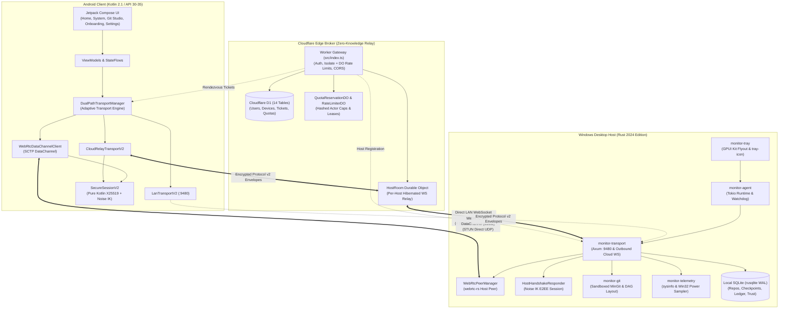

# Architecture and System Design

**Monitor (v1.0.0)** is a hybrid peer-to-peer / edge-brokered distributed workstation management platform pairing a Rust Windows desktop host with a Kotlin Android companion application.

---

## 1. System Topology

---

## 2. Windows Desktop Host Subsystem (`desktop/`)

Compiled under **Rust Edition 2024** (`resolver = "3"`, `x86_64-pc-windows-msvc` static CRT `+crt-static`) with workspace-enforced `#![deny(unsafe_code)]`, `#![deny(clippy::unwrap_used, clippy::expect_used, clippy::panic)]` policies (explicit `#[allow(unsafe_code)]` scoped strictly to Win32 FFI modules/crates).

### 2.1 Eight-Crate Architecture

| Crate | Responsibility | Verified Direct Dependencies |
| --- | --- | --- |
| **`monitor-core`** | Domain DTOs, Protocol v2 `EnvelopeV2` (28 `MessageType` variants), operation tier classifier (`T0`-`T3`), SHA-256 `canonical_params_hash`, and auto-generated `BrandConfig`. | `serde`, `serde_json`, `schemars`, `thiserror`, `uuid`, `sha2` |
| **`monitor-storage`** | Dual-handle SQLite WAL persistence (`conn` + read-only `read_conn` with `query_only = ON`), 5 migrations (`001`-`004` + fail-closed permission defaults), repository/checkpoint storage, permanent `viewer_trust` revocation tombstones, and idempotent `command_ledger`. | `monitor-core`, `rusqlite` (`bundled`, `backup`, `uuid`), `tracing`, `chrono`, `serde`, `serde_json` |
| **`monitor-telemetry`** | Windows hardware telemetry sampler (2s TTL cache, 60m CPU/RAM ring history, per-core CPU, memory/swap, mounted disks, top processes, process kill with `0`/`4`/self protection, Win32 `GetSystemPowerStatus`). *(No GPU or network traffic counters.)* | `monitor-core`, `sysinfo` (`0.33.1`), `windows-sys`, `chrono`, `thiserror` |
| **`monitor-git`** | Sandboxed Git CLI executor (portable MinGit + `MONITOR_GIT_PATH` + shim resolution, canonical `path_guard`, `protocol.ext.allow=never`), 32-lane DAG layout (`compute_dag_geometry`), 500-line/128 KiB capped diffs, GitHub PR CLI/API integration, secret log redaction, and shadow `CheckpointEngine`. | `monitor-core`, `tokio`, `tracing`, `serde`, `serde_json`, `chrono`, `reqwest` |
| **`monitor-transport`** | Axum HTTP/WS server (`0.0.0.0:9480` guarded by `private_peer_only` + loopback-only `native_client_only`), `127.0.0.1:9481` Google OAuth PKCE callback, `Noise_IK_25519_ChaChaPoly_SHA256` (`snow` + `chacha20poly1305`), `webrtc 0.21.1` host peer, DPAPI `key_storage/`, Win32 Job Object terminal runner (`terminal_handlers/`), `TelemetryBus`, and `HostRoom` WSS controller. | `monitor-{core,git,storage,telemetry}`, `axum`, `tokio`, `tokio-tungstenite`, `webrtc`, `snow`, `chacha20poly1305`, `sha2`, `subtle`, `rand`, `reqwest`, `windows-sys` |
| **`monitor-agent`** | Embedded Tokio runtime, 14-agent process classifier (`UNIVERSAL_AGENT_CATALOG`), `.git/index` mtime activity fallback, dirty-tree auto-checkpoint pipeline, alert rules, `SetThreadExecutionState` keep-awake, and alert push client. | `monitor-{core,storage,telemetry,git,transport}`, `tokio`, `tracing`, `anyhow`, `sysinfo`, `serde_json`, `chrono`, `reqwest`, `windows-sys` |
| **`monitor-tray`** | Native Windows system tray binary (`monitor.exe`) combining `tray-icon 0.26.1` (left-click toggle; no Win32 context menu) with an executive `332x400` **GPUI Kit (`0.10.0`)** glass flyout (`Projects`, `Mobile & Devices` OTP/QR + `T2`/`T3` switcher, `Permissions`, `Cloud`, `System Monitor`, `Notifications`, `Settings`), single-instance TCP lock (`127.0.0.1:9489`), and Win32 DPI/wallpaper tint detection. | `monitor-{core,agent}`, `gpui-kit`, `tray-icon`, `reqwest`, `qrcode`, `rfd`, `winreg`, `sysinfo`, `windows`, `raw-window-handle` |
| **`monitor-installer`** | Standalone GPUI Kit Windows Native Glass installer (`monitor-installer`), Solid Zstd level-19 packer (`pack-payload`, `MONPAK01` inside `payload.zip` + SHA-256 verification), and slim `monitor-uninstaller` with delayed self-cleanup. | `monitor-core`, `gpui-kit`, `zstd`, `zip`, `winreg`, `sha2`, `rfd`, `sysinfo`, `windows-sys` |

### 2.2 Thread, Process & Persistence Model
- **Main UI Thread:** Drives the `gpui-kit` window event loop and `tray-icon` message pump (`127.0.0.1:9489` `TcpListener` enforces single instance).
- **Tray I/O Thread:** Dedicated background thread polling `/local/status` and dispatching UI actions over loopback HTTP without blocking GPUI renders.
- **Tokio Async Runtime (`EmbeddedAgent`):** Executes Axum HTTP/WS serving, `HostRoom` relay, WebRTC peer connections, watchdog polling (`3s` tick / `15s`-`30s` checkpoint scans), and telemetry sampling (`2s`).
- **Terminal Child Confinement:** Remote commands (`POST /projects/{id}/terminal/run`) execute inside Win32 Job Objects configured with `JOB_OBJECT_LIMIT_KILL_ON_JOB_CLOSE` (max 32 concurrent jobs, 60s timeout, 128 KiB output cap).

---

## 3. Android Mobile Client Subsystem (`android/`)

Built with **Kotlin `2.1.0`**, **AGP `8.8.2`**, **Gradle `8.13`**, **Jetpack Compose BOM `2025.02.00`**, Java `21`, targeting **`minSdk = 30`**, **`compileSdk = 35`**, **`targetSdk = 35`** across all 8 modules.

### 3.1 Module Breakdown

| Module | Purpose | Key Verified Components |
| --- | --- | --- |
| **`:app`** | App initialization (`MonitorApp`), 5-tab navigation (`Home`, `Projects`, `Git`, `System`, `Settings`), root biometric gating (`AppLockGate`), validated handover observer (`DesktopConnectionObserver`), notification actions (`AlertNotificationManager`, `AlertActionReceiver`), and foreground connection service (`ActiveSessionService`, `SessionActionReceiver`). | `MonitorApp`, `MainActivity`, `MainTabNavigator`, `DesktopConnectionObserver`, `AppLockGate`, `ActiveSessionService` |
| **`:core:common`** | `BrandConfig`, API 30+ `BiometricAuthManager`, pure app-lock policies (`AppLockAuthPolicy`, `AppLockLifecyclePolicy`), `DestructiveActionGate`, exponential `ReconnectPolicy`, and `AlertNotifier`. | `BrandConfig`, `BiometricAuthManager`, `DestructiveActionGate`, `ReconnectPolicy` |
| **`:core:model`** | Kotlinx Serialization Protocol v2 wire models aligned with `monitor-core`. | `EnvelopeV2`, `MessageTypeV2`, `SystemSnapshot`, `GitModels`, `CommitNode`, `CheckpointItem`, `AgentSessionSummary` |
| **`:core:network`** | Transport racing & failover, pure Kotlin RFC 7748 `X25519`, Noise IK handshake/framing (`MAX_PLAINTEXT_SIZE = 16384`), 8 KiB chunk reassembly (`EnvelopeChunkAssembler`), TOFU `HostKeyPinning`, `LanEndpointPolicy`, hardware-backed `SecureStorage`, and `TokenStorage`. | `DualPathTransportManager`, `LanTransportV2`, `WebRtcDataChannelClient`, `CloudRelayTransportV2`, `V2TransportCoordinator`, `MonitorApiClient`, `SecureStorage`, `TokenStorage` |
| **`:core:designsystem`** | Dark Obsidian Glass & Light Aurora theming, tabular typography, acrylic floating bottom dock, metric/graph canvases, and vector branding. | `MonitorTheme`, `OxygenGlassCard`, `BottomNavigationBar`, `MetricChartCanvas`, `DiffViewer` |
| **`:feature:dashboard`** | Live dashboard (`HomeScreen`), 3-tab system monitor (`SystemScreen`), watchdog checkpoints sheet (`+ Save` + rollback), modularized Settings (7 collapsible cards + statutory legal dialogs), and `SettingsViewModel` / `BrokerProbeClient`. | `DashboardViewModel`, `HomeScreen`, `SystemScreen`, `SettingsScreen`, `SettingsViewModel`, `CheckpointsBottomSheet` |
| **`:feature:gitworkspace`** | Interactive 32-lane Bezier DAG studio (`GitGraphScreen`, `ContinuousGitGraphCanvas`), commit files + diff hunks (`FileDiffInspectorBottomSheet`), branch ops, GitHub PR merge, and command terminal (`ProjectTerminalBottomSheet`). | `GitWorkspaceViewModel`, `ProjectWorkspaceScreen`, `GitGraphScreen`, `ProjectTerminalBottomSheet` |
| **`:feature:onboarding`** | Animated welcome + pairing flow (`OnboardingScreen`, `PairingScreen`) supporting ML Kit QR scanning, Google Sign-In (`CloudAuthService`), manual 6-digit OTP + LAN IP/Port, non-GMS fallback, and **"Verify This Device"** `T3 Admin` gate. | `OnboardingViewModel`, `OnboardingScreen`, `PairingScreen`, `CloudAuthService` |

---

## 4. Cloudflare Edge Broker Subsystem (`cloud/`: Private Master Monorepo)

Implemented in TypeScript on Cloudflare Workers (`compatibility_date: 2026-11-01`, `nodejs_compat`) backed by Cloudflare D1 and SQLite Durable Objects.

### 4.1 Verified Edge Components & Bindings (`cloud/wrangler.jsonc`)
- **Gateway Router (`cloud/src/index.ts`):** Enforces security headers (`HSTS`, `CSP`, `X-Content-Type-Options`), strict origin CORS, isolate-first rate limiting + selective `RateLimiterDO` escalation (`240/60s` IP, `180/60s` actor), and routes:
  - `routes/health.ts` (`/health`, `/`, `/api/health`, `/api/v1/health`)
  - `routes/google_exchange.ts` (`/api/v1/auth/google-exchange` PKCE BFF) & `routes/google_verify.ts` (`/api/v1/auth/google-verify` RS256 JWKS + `tokeninfo` fallback)
  - `routes/devices.ts` (`/api/v1/devices`), `routes/device_reservations.ts` (`/api/v2/devices/reservations`), `routes/device_activation.ts` (`/api/v2/devices/activate`), `routes/device_offline.ts` (`/api/v1/devices/offline`)
  - `routes/host_tickets.ts` (`/api/v2/hosts/noise-key`, `/api/v2/hosts/tickets`, `/api/v2/sessions`, `/api/v2/webrtc/turn-credentials`)
  - `routes/rendezvous.ts` (`/api/v2/rendezvous/host`, `/api/v2/rendezvous/viewer`)
  - `routes/heartbeat.ts` (`/api/v1/devices/heartbeat`, 64 KB body cap), `routes/telemetry.ts` (`/api/v1/telemetry`, presence only)
  - `routes/git_state.ts` (`503 LIVE_SESSION_REQUIRED`), `routes/git_operations.ts`, `routes/process_control.ts`, `routes/watchdog.ts`, `routes/terminal.ts`, `routes/auth.ts`, `routes/alerts.ts`, `routes/relay.ts` (`410 Gone` legacy shim)
  - `routes/turn_emergency.ts` & `financial_safety.ts` (`/api/admin/turn/*`, `/api/admin/financial/refresh`)
- **Three Durable Objects:**
  1. **`HostRoom` (`src/host-room.ts`):** Per-host WebSocket Hibernation relay (max 5 concurrent viewers, 16,400-byte frame limit, 5s+jitter offline DO alarm, `/internal/alert` push bridge).
  2. **`RateLimiterDO` (`src/rate_limiter.ts`):** Fixed-window limiter keyed by SHA-256 actor hashes with 24h cleanup alarm.
  3. **`QuotaReservationDO` (`src/quota_reservation.ts`):** Lease coordinator for bounded global TURN (`N <= 5`, 600s TTL) and alert push (`N <= 4`, 60s TTL) concurrency.
- **D1 Schema (`cloud/schema.sql`, migrations `0001`-`0006`):** 14 relational tables (`users`, `devices`, `device_reservations`, `rendezvous_tickets`, `sessions` [SHA-256 tokens], `device_commands`, `push_subscriptions`, `broker_alerts`, `rate_limits`, `turn_credentials`, `financial_safety_events`, `financial_safety`, `quota_snapshots`, `daily_usage_counters`). Zero telemetry or Git repository payloads are stored in D1 (`0001_zero_storage_telemetry.sql`).
- **Scheduled Crons:** `*/5 * * * *` (GraphQL Realtime usage watchdog + `quota_snapshots` refresh + coalesced counter flush) and `0 3 * * *` (10-step expired D1 record cleanup).

---

## 5. Persistence Boundaries and Security Storage

| Layer | Storage Engine | Contents | Security Mechanism |
| --- | --- | --- | --- |
| **Desktop Local** | SQLite (`%LOCALAPPDATA%\Monitor\monitor.db`, WAL mode) + Windows Registry (`HKCU`) | Registered repos, checkpoints, watchdog alerts/sessions, viewer trust tiers (`T0`-`T3`), idempotent `command_ledger`, host settings, Noise keys. | `host_noise_private_key` sealed via Windows DPAPI `CryptProtectData` (`dpapi2:`); pairing/session tokens stored as SHA-256 hashes. *(Note: `cloud_account` metadata JSON in local SQLite `settings` is currently stored unencrypted.)* |
| **Android Local** | `SecureStorage.kt` (`filesDir/monitor_secure_store_v1.bin`) + SharedPreferences (UI prefs) | `device_token`, `cloud_session_token`, `noise_static_private/public`, `cloud_device_verified`, TOFU host pins. | Atomic `"MONS"` v1 binary envelope encrypted with hardware-backed `AndroidKeyStore` AES-256-GCM master key (`app.monitor.secure.master.v1`). |
| **Cloud Edge** | Cloudflare D1 + SQLite DOs | User emails/IDs, device keys/IPs, 60s single-use tickets, hashed session tokens, `quota_snapshots`, `daily_usage_counters`. | Strictly zero telemetry/Git/terminal payload storage; SHA-256 hashed actor keys and session tokens. |
| **In-Flight** | LAN WS / WebRTC / HostRoom WSS | Telemetry, Git DAG/diffs, checkpoints, OTP verification, terminal output. | End-to-end encrypted (`Noise_IK_25519_ChaChaPoly_SHA256` & derived ChaCha20Poly1305 DataChannel keys). |
