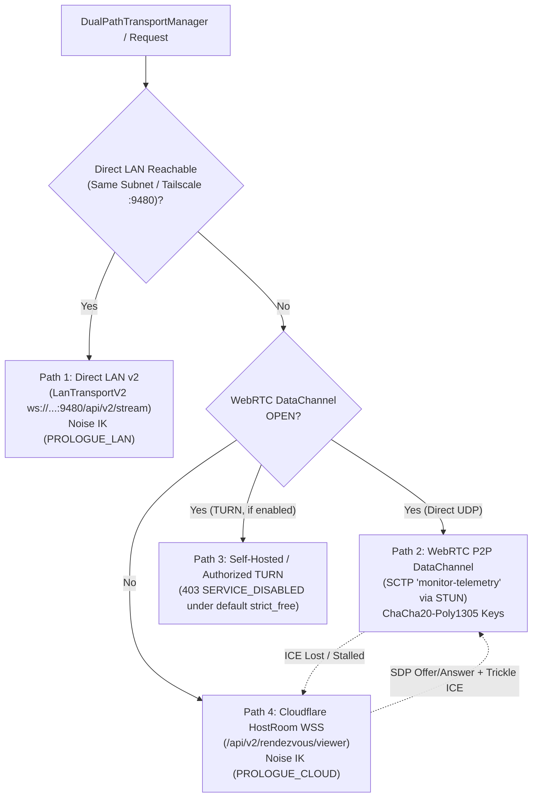
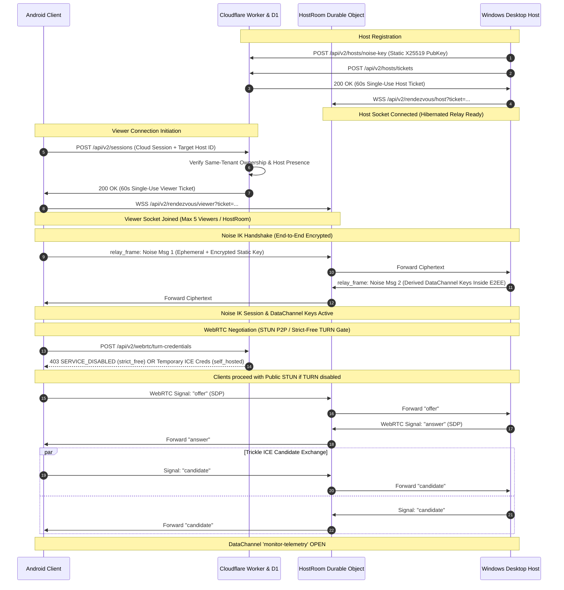

# Networking and Transport Architecture

**Monitor** implements an adaptive quad-path transport hierarchy engineered for sub-millisecond local network responsiveness while preserving resilient, end-to-end encrypted remote connectivity across NATs, firewalls, and mobile network handovers.

---

## 1. Transport Hierarchy & Route Selection

| Path | Transport | Protocol & Security | Availability & Role |
| --- | --- | --- | --- |
| **Direct LAN v2** | TCP / WebSocket (`:9480`) | `Noise_IK_25519_ChaChaPoly_SHA256` (`MONITOR_V3_2_LAN_V2`) + TOFU `HostKeyPinning` + `LanEndpointPolicy` | Primary path on same LAN subnet, emulator (`10.0.2.2`), or Tailscale CGNAT (`100.64.0.0/10`). |
| **WebRTC P2P DataChannel** | UDP / SCTP (`monitor-telemetry`) | Separate symmetric ChaCha20-Poly1305 keys derived during Noise IK (`SecureSessionV2`) + STUN (`stun.cloudflare.com:3478`, `stun.l.google.com:19302`) | Primary low-latency remote path via direct NAT hole-punching. |
| **WebRTC TURN Relay** | UDP/TCP / SCTP | Optional operator-owned TURN or budget-guarded relay | **Disabled by default (`403 SERVICE_DISABLED`)** under `strict_free` zero-spend policy; remote sessions fall back directly to HostRoom WSS unless enabled. |
| **Cloudflare HostRoom WSS** | TLS / WebSocket | `Noise_IK_25519_ChaChaPoly_SHA256` (`MONITOR_V3_2_CLOUD_V2`) via Hibernated `HostRoom` DO | Signaling channel for WebRTC negotiation, remote OTP verification, and reliable encrypted fallback relay. |

> **Discovery Mechanism (No mDNS):** Monitor does **not** use multicast mDNS (UDP 5353). Local host addresses are discovered via a non-routed UDP socket probe (`network::discover_local_ipv4`), Tailscale CLI (`tailscale ip --4`), Tray QR codes, and Cloudflare `host_metadata` push events. Desktop HTTP/WS binding enforces `private_peer_only` IP validation (`127.0.0.0/8`, RFC1918, `100.64.0.0/10`, IPv6 `::1`).

---

## 2. Remote Session Establishment & Signaling Flow

---

## 3. Instant Network Handover & Recovery

When switching between Wi-Fi and Cellular (5G/LTE):

1. **`DesktopConnectionObserver` (`ConnectivityManager.registerDefaultNetworkCallback`):**
   Tracks active network ID, transport mask (`WIFI`, `CELLULAR`, `ETHERNET`, `VPN`), and `NET_CAPABILITY_VALIDATED` (`lastValidated`), debounces transitions (`120ms`), and invokes `viewModel.reconnect()` -> `apiClient.notifyNetworkChanged()`.
2. **`DualPathTransportManager.onNetworkChanged()`:**
   - Evicts stale OkHttp socket pools (`evictMonitorHttpPool`).
   - Closes dead `webrtcClient` handles and resets stale `WEBRTC_P2P` route indicators.
   - Advances `networkEpoch` across `LanTransportV2` and `CloudRelayTransportV2`, immediately canceling in-flight ticket polls and invoking `promoteFallbackPath()`.
   - Dynamically checks updated `tokenStorage.getServerHost()` inside `raceTransportsAndStream` so returning from cellular to home Wi-Fi upgrades automatically back to `LAN_DIRECT`.
3. **Host-Side Idle Telemetry Savings & Handover:**
   When all viewers disconnect from `HostRoom` (`all_viewers_disconnected`), the desktop host pauses cloud telemetry broadcasting while remaining awake on hibernated WSS; remote unverified phones can still verify OTPs via `auth.verify_otp` over HostRoom before promoting to `T3 Admin`.

---

## 4. Protocol v2 Framing, Chunking & Correlation

- **`EnvelopeV2` Frame Cap:** `MAX_PLAINTEXT_FRAME_SIZE = 16,384` bytes (`16 KiB`), plus `16`-byte ChaCha20-Poly1305 tag (`MAX_CIPHERTEXT_FRAME_SIZE = 16,400` bytes enforced by `HostRoom`).
- **Application-Layer Chunking (`split_v2_envelope` / `EnvelopeChunkAssembler`):**
  Large responses (Git graphs, diffs, process snapshots, workspace trees) are fragmented into **8 KiB** (`8192` bytes) base64 chunks wrapped in `{ "_frame_chunk": true, "chunk_id", "index", "count", "data" }`. Receivers validate bounds (`max 512 chunks`, **4 MiB** max assembled size, **30s** assembly TTL).
- **RPC Priority (`DualPathRpc`):**
  For authenticated requests, `MonitorApiClient.v2RequestIfCloud` routes to LAN REST if locally active and not in 8s cooldown; otherwise `DualPathTransportManager.requestOperation` dispatches `COMMAND_REQUEST` over the best open E2EE path (`LAN_DIRECT` 4s/25s -> `WEBRTC_*` 8s/40s -> `CLOUD_RELAY_WSS` 15s/60s) via `V2RequestCorrelator` (max 32 pending requests, 60s timeout).
